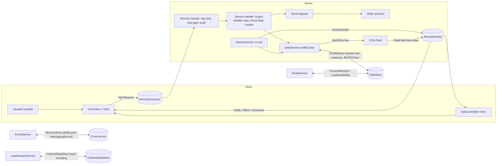

# Stage 3: Architecture

This document is the contract between all modules. Code must match the names, signatures and
validation rules below. Numbers never appear here or in code; they live in
`src/ReplicatedStorage/Shared/Config.luau`.

## 1. Explorer tree (Rojo → Studio)

```
ReplicatedStorage
└─ Shared                         (src/ReplicatedStorage/Shared)
   ├─ Config            ModuleScript  every tunable number, price, odds, timer, colour
   ├─ Types             ModuleScript  persisted PlayerData schema + Response type
   ├─ DataTemplate      ModuleScript  defaults for new players, Reconcile()
   ├─ Migrations        ModuleScript  versioned data upgrades (Steps[v])
   ├─ Formulas          ModuleScript  pure economy math (costs, output, Shares, offline…)
   ├─ ContractOdds      ModuleScript  free blueprint odds + pity (disclosed in UI)
   ├─ TradeLogic        ModuleScript  pure trade validation + atomic swap
   ├─ ReceiptLedger     ModuleScript  ProcessReceipt idempotency
   ├─ NumberFormat      ModuleScript  1.23K / 4.5Qa / durations
   ├─ Net               ModuleScript  remote registry (+ client Request helper)
   ├─ Signal            ModuleScript  pure signal
   └─ Maid              ModuleScript  connection/instance cleanup
   Remotes (Folder, created at runtime by Net.Setup)

ServerScriptService
├─ Main                 Script        boots services: Init() all, then Start() all
├─ ServerPackages       (Wally)       ProfileStore
├─ Server               (helpers, ModuleScripts)
│  ├─ Remote            Handle(name, fn) with rate limit + load gate + pcall; Fire/Notify
│  ├─ Guard             argument validators
│  ├─ Retry             pcall + exponential backoff with jitter
│  ├─ ServerSignals     in-process events between services
│  ├─ RuntimeState      per-player non-persisted state
│  └─ Grants            GrantMachine / GrantBoost / GrantIncomeMinutes / GrantCredits / GrantTitle
└─ Services             (ModuleScripts, each { Init: () -> (), Start: () -> () })
   ├─ AntiExploitService   L0
   ├─ DataService          L1
   ├─ CurrencyService      L2
   ├─ StatsService         L2
   ├─ PassService          L2
   ├─ EventService         L2
   ├─ PlotService          L2
   ├─ SocialBonusService   L2 (after PlotService)
   ├─ MultiplierService    L3
   ├─ FactoryService       L4
   ├─ ExpansionService     L5
   ├─ OfflineEarningsService L5
   ├─ TutorialService      L5
   ├─ MachineService       L5
   ├─ ContractService      L5
   ├─ ResearchService      L5
   ├─ QuestService         L5
   ├─ DailyRewardService   L5
   ├─ CodeService          L5
   ├─ LeaderboardService   L5
   ├─ TradeService         L6
   ├─ ShopService          L6
   └─ AdminService         L7

ServerStorage
├─ Builders             (ModuleScripts, procedural geometry)
│  ├─ BuildKit          part/mesh helpers, materials, tweens, particles
│  ├─ WorldBuilder      lighting, ground, plaza, spawn, leaderboards, trade plaza, VIP lounge
│  ├─ PlotBuilder       plot shell, floors, lines, belts, levers, vault pad, dock, bays, rocket pad
│  └─ MachineModelBuilder  specialist machine models from Config.Visuals shape keys
└─ ModelOverrides       (optional Folder) real models that replace procedural ones

StarterPlayer.StarterPlayerScripts
├─ ClientMain           LocalScript   boots controllers: Init() all, then Start() all
├─ UI
│  └─ UIKit             ModuleScript  Scale-based, gamepad-selectable widgets
└─ Controllers          (ModuleScripts, each { Init?: () -> (), Start?: () -> () })
   ├─ DataController, UIController, SoundController, NotificationController, InputController
   ├─ HUDController, FactoryController, ExpansionController, TutorialController,
   │  OfflineController, SettingsController
   ├─ ShopController, MachinesController, ContractsController, ResearchController,
   │  CatalogController, QuestsController, TradeController, LeaderboardController,
   │  CodesController, AdminController
   └─ VisualsController  conveyor items (pooled), trucks, effects, floating text, rockets

StarterGui
└─ FactoryUI            ScreenGui (ResetOnSpawn=false, IgnoreGuiInset=true); layers built by UIController

Workspace (StreamingEnabled = true)
├─ Plaza                built at runtime by WorldBuilder
└─ Plots                Plot_1 … Plot_8 built at runtime by PlotBuilder
```

## 2. Boot order and layering

`Main.server.luau` requires every service in the order listed above, calls `Init()` on all of
them, then `Start()` on all of them (each `Start` in its own `task.spawn`).

- A service may `require` only services in a **lower** layer (L0 < L1 < … < L7) and the
  `Server/*` helpers. Upward communication uses `ServerSignals` (fire in the owner, subscribe in
  `Start()`), which removes require cycles.
- `Init()` must not yield; it sets up state and binds remotes with `Remote.Handle`.
- `Start()` connects `Players.PlayerAdded/PlayerRemoving` (and loops over players already in game).
- One shared heartbeat: `FactoryService` runs a single 1-second `task.wait` loop for all players.
  No service uses `RunService.Heartbeat` on the server except `AntiExploitService` (1 Hz loop too).

## 3. Client ⇄ server data flow



**Authority:** the client never sends amounts, prices, odds or results. It sends *intent*
(`UpgradeStage(line, stage, count)`); the server recomputes cost from `Formulas`, checks the
profile, mutates, and replicates. The client mirror is display-only.

**Replication:** `DataService.MarkDirty(player, key)` queues a top-level key of `PlayerData`;
every `Config.Data.ReplicationFlushSeconds` the queued keys are sent as `DataPatch(key, value)`.
On join the full snapshot is sent once with `DataSync`. Non-persisted per-tick values
(income/s, line outputs, overdrive timers) go out once per second via `RuntimeState`.

## 4. Remotes

Every RemoteFunction returns `Response = { Ok: boolean, Error: string?, Data: any? }`.
`Remote.Handle` applies, before the handler runs: per-player rate limit
(`Config.AntiExploit.Rates[name]` or `DefaultRate`; exceeding it adds an anti-exploit strike),
a load gate (data must be loaded), and `pcall`. Handlers validate every argument with `Guard`.

| Remote | Args | Validation (server) | Owner |
|---|---|---|---|
| BuyLine | – | next line index ≤ hall limit for Expansions; cash ≥ cost | FactoryService |
| UpgradeStage | line: int, stage: int, count: int | line owned (1..#Lines), stage 1..4, count ∈ {1,10,0=max}; cost from Formulas incl. discount; cash ≥ cost; level cap | FactoryService |
| Overdrive | line: int, hostUserId: int? | own line: cooldown ready. Host given: host in server, friends (if FriendsOnlyOperators), operator within OperatorMaxDistance of host's lever; host line owned | FactoryService (+SocialBonusService) |
| CollectVault | – | Vault > 0; character within Vault.CollectDistance of own vault pad (HUD button) | FactoryService |
| BuyPackaging | hall: int | hall unlocked, tier < max, cash ≥ cost | FactoryService |
| BuyVault | – | tier < max, cash ≥ cost | FactoryService |
| AssignRobot | robot: int, line: int | robot ≤ RobotsFor(); line owned or 0; MaxPerLine | FactoryService |
| BuyMachine | machineId: string | def exists, Source Shop/Credits, hall unlocked, price via Formulas.MachinePrice, inventory limit | MachineService |
| EquipMachine | uid: string, bay: int | uid owned, bay ≤ BaysFor(); not being plated; same uid not in another bay | MachineService |
| UnequipMachine | bay: int | bay in range | MachineService |
| MergeChrome | uid: string | uid Standard; ChromeMergeCount identical unlocked unequipped Standard copies | MachineService |
| StartPlating | uid: string | uid Chrome; GoldMergeCount identical unequipped Chrome; plating slot idle | MachineService |
| ClaimPlating | – | plating finished | MachineService |
| LockMachine | uid: string, locked: bool | uid owned | MachineService |
| ClaimContract | slot: int | slot in range, Done or Progress ≥ Target, not expired | ContractService |
| MegaCreate / MegaJoin | – / megaId: string | not in another mega; join window; MaxPlayers; cooldown | ContractService |
| StartResearch | id: string | def exists, level < Max, no active project, credits ≥ cost | ResearchService |
| ClaimResearch | – | active project finished | ResearchService |
| TrySecretRecipe | lines: {int} (3) | exactly 3 distinct owned lines; each ≥ MinLevel for a match; not yet discovered | ResearchService |
| Expand | – | Formulas.CanExpand(Expansions, RunEarnings) | ExpansionService |
| Franchise | – | Formulas.CanFranchise(Expansions) | ExpansionService |
| ClaimQuest | kind: "Daily"/"Weekly", index: int | quest exists, Progress ≥ Target, not claimed | QuestService |
| ClaimDailyQuestBonus | – | all 3 daily claimed, bonus unclaimed | QuestService |
| ClaimDaily | machineChoice: string? | ClaimCooldownHours since last; day-7 choice must be a Rare of an unlocked hall | DailyRewardService |
| ClaimSupplyDrop | – | Stored ≥ 1 | DailyRewardService |
| ClaimOffline | – | PendingCash > 0 | OfflineEarningsService |
| ClaimGlobalGoal | – | week matches, personal contracts ≥ MinPersonalContracts, next tier reached | EventService |
| RedeemCode | code: string (≤ 32) | exists (case-insensitive), not expired, not redeemed | CodeService |
| SetTitle | title: string | title owned or "" | SocialBonusService |
| TradeRequest | targetUserId: int | target in server, not self, both eligible (account age, playtime, policy), no active session, cooldown | TradeService |
| TradeRespond | requestId: string, accept: bool | request addressed to caller, not expired | TradeService |
| TradeSetOffer | uids: {string} | session member; TradeLogic.ValidateOffer; resets both Ready flags; bumps revision | TradeService |
| TradeReady | ready: bool, revision: int | revision matches current | TradeService |
| TradeConfirm | revision: int | both Ready; countdown elapsed; revision matches; both profiles active → TradeLogic.Execute | TradeService |
| TradeCancel | – | session member | TradeService |
| PromptPass | passKey: string | key in Config.GamePasses, Id ≠ 0, not owned | ShopService |
| PromptProduct | productKey: string, giftUserId: int? | key in Config.DevProducts, Id ≠ 0, OneTime not bought, gift target in server and product Giftable | ShopService |
| WatchAd | placement: string | Config.Ads.Enabled, placement known, cooldown, MaxPerDay | ShopService |
| MarkOfferSeen | offer: string | known offer key | ShopService |
| RequestSnapshot | – | data loaded; resends DataSync (late clients) | DataService |
| SetSetting | key: string, value: bool | key ∈ Settings | DataService |
| TutorialAdvance | action: "Skip"/"Ack", step: int | step == current step | TutorialService |
| GetLeaderboards | – | none (read-only cache) | LeaderboardService |
| AdminCommand | cmd: string, args: table | caller is admin (creator, Config.Admin.UserIds, group rank); per-command arg guards | AdminService |

Server → client events: `DataSync(snapshot)`, `DataPatch(key, value)`, `Notify(kind, text, payload?)`,
`Effect(kind, payload)`, `RuntimeState(state)`, `EventState(state)`, `TradeUpdate(state)`,
`TradePrompt(requestId, fromUserId, fromName)`, `Announce(text, color)`, `AdminData(metrics)`.

`Effect` kinds: `LevelMilestone {Line, Level}`, `LineBuilt {Line}`, `ContractStamp {Tier, Cash, Credits, Blueprint?}`,
`Expansion {Count, Shares, Mult}`, `Franchise {Level}`, `Rocket {UserId}`, `MachineGranted {Id, Rarity}`,
`VaultCollected {Amount}`, `Offline {Cash, Seconds}`, `SecretDiscovered {Id}`.

`RuntimeState` payload: `{ Income: number, Multiplier: number, VaultCapacity: number, Discount: number,
Lines: { { Output: number, Bottleneck: number, OverdriveLeft: number, CooldownLeft: number, Robot: boolean } },
Operators: number, Robots: number, OfflineCapHours: number, Abilities: {[string]: number} }`.

`EventState` payload: `{ RushActive, RushSecondsLeft, WeekendActive, ForcedRushUntil, ForcedWeekendUntil,
GlobalGoal = { WeekKey, Total, Tiers }, NextUpdateUnix, ServerTime }`.

## 5. Service API contract

Signatures are Luau; `PlayerData` = `Types.PlayerData`.

**AntiExploitService (L0)** `CheckRate(player, remoteName): boolean` · `Strike(player, reason, details?)` ·
`AllowTeleport(player, seconds?)` · `Log(kind, player?, details)` · `IsBannedAsync(userId): (boolean, string?)` ·
`BanAsync(userId, reason, minutes)` (0 = permanent) · `UnbanAsync(userId)` · `GetRecentLogs(): {any}`.
Movement check 1 Hz: horizontal speed and teleport distance vs `Config.AntiExploit`; strikes decay;
kick at `StrikesToKick`; logs flushed to a DataStore with `Retry`.

**DataService (L1)** `Get(player): PlayerData?` · `WaitFor(player, timeout?): PlayerData?` · `IsLoaded(player): boolean` ·
`GetProfile(player): any?` · `MarkDirty(player, key)` · `SendSnapshot(player)` · `GetLoadedPlayers(): {Player}` ·
`MessageUserAsync(userId, message): boolean` (ProfileStore `MessageAsync`, used for offline referral credit) ·
Signals `Loaded(player, data)`, `Releasing(player, data)`, `MessageReceived(player, message)`.
ProfileStore session per `Player_<UserId>`, `Cancel` while the player is still in game, `AddUserId`,
`Migrations.Migrate` after load, `OnSessionEnd` kicks, `ProfileStore.Mock` when Studio has no API access.
ProfileStore autosaves every 300 s and saves on `BindToClose`; DataService also ends every session on
`BindToClose`. Bans checked before the session starts.

**CurrencyService (L2)** `GetCash/GetCredits(player): number` ·
`AddCash(player, amount, source, countsAsEarnings?)` (default true: also adds RunEarnings, FranchiseEarnings,
TotalEarnings, WeeklyEarnings with week rollover; fires `CashEarned`) · `SpendCash(player, amount): boolean` ·
`AddCredits(player, amount, source)` · `SpendCredits(player, amount): boolean` ·
`DepositVault(player, amount, capacity): number` · `CollectVault(player): number`.

**StatsService (L2)** `Increment(player, key, amount)` (Data.Stats; fires `StatChanged`) ·
leaderstats folder with `Cash` and `Industry` StringValues refreshed every 2 s.

**PassService (L2)** `Owns(player, passKey): boolean` · `Refresh(player)` · `IsPremium(player): boolean`.
Ownership via `UserOwnsGamePassAsync` (Retry) on join, `PromptGamePassPurchaseFinished`, cached in Data.Passes.
VIP grants the Golden Robot once (via Grants).

**Grants (helper, L2)** `GrantMachine(player, id, source, grade?): string?` (uid; inventory limit;
announce rarities in `Config.Events.AnnounceRarities`; fires `MachineGranted`, Effect) ·
`GrantBoost(player, key, minutes)` (extends expiry) · `GrantIncomeMinutes(player, minutes, source): number`
(uses `RuntimeState.IncomePerSecond`, min 1 $/s) · `GrantCredits(player, amount, source)` ·
`GrantTitle(player, title)` · `IsBoostActive(data, key): boolean` · `BoostMult(data): number`.

**EventService (L2)** `GetState(): EventState` · `IsRushActive(): boolean` · `IsWeekend(): boolean` ·
`ForceEvent(kind, minutes, global)` (MessagingService `Config.Events.MessagingTopic`) ·
`Announce(text, color, global)` · `GetGlobalTotal(): number`. Subscribes `ContractCompleted` → buffer;
flush to MemoryStore SortedMap key `WeekKey` with `UpdateAsync` every `FlushSeconds`, poll total every
`PollSeconds`. Remote `ClaimGlobalGoal`. Broadcasts `EventState` every 5 s.

**PlotService (L2)** `GetPlot(player): Model?` · `GetPlotOwner(model): Player?` · `GetVaultPosition(player): Vector3?` ·
`GetLeverPosition(player, line): Vector3?` · `GetSpawnCFrame(player): CFrame?` · `TeleportHome(player)`.
Claims a free plot on load, builds it via `PlotBuilder`, sets `OwnerUserId` attribute, marks the plot model
`PersistentPerPlayer` for its owner, updates visuals on `LinesChanged`/`Expanded`/`Franchised`, frees on leave.

**SocialBonusService (L2)** `GetOperatorCount(host): number` · `RegisterOperatorPull(operator, host): (boolean, string?)` ·
`IsInGroup(player): boolean` · `GetTeamworkActive(host): boolean`. Handles referrals
(`GetJoinData().ReferredByPlayerId`, credited after `ReferralMinPlaySeconds`, offline via `DataService.MessageUserAsync`),
invite rewards, group reward, Apprentice buff, `SetTitle` remote.

**MultiplierService (L3)** `Get(player): number` · `GetParts(player): Formulas.MultiplierParts` ·
`GetAbilities(player): {[string]: number}` · `GetUpgradeDiscount(player): number` (Bargain + Fast Tooling, capped) ·
`GetProductionMult(player): number` (Turbo Conveyors) · `GetOfflineEfficiency(player)` · `GetOfflineCapHours(player)` ·
`GetVaultBonus(player)` · `GetOverdriveSeconds(player)` · `Invalidate(player)`.
Recomputes on `MultipliersDirty`, on `PassOwned`, and every 5 s (boost expiry, events).

**FactoryService (L4)** `GetIncome(player): number` · `GetLineOutput(player, line): number` · `ResetRun(player)`.
Remotes: BuyLine, UpgradeStage, Overdrive, CollectVault, BuyPackaging, BuyVault, AssignRobot.
1 s tick: output per line (`Formulas.LineOutput` with robot, overdrive, production mult), income = Σ output ×
value × (1 + packaging) × multiplier; deposits to Vault (or wallet with Auto-Collect); fires `Produced`,
`StatChanged(ProductsShipped)`; rockets every `Config.World.RocketLaunchEvery` Rockets; catalog stamps on level
change; robots auto-Overdrive; operator expiry; sends `RuntimeState`.

**ExpansionService (L5)** remotes Expand, Franchise. Expand: Expansions += 1, Shares = SharesTotal(FranchiseEarnings)
+ BonusShares, `FactoryService.ResetRun`, bays/robots grow, fire `Expanded`, Effect. Franchise: Franchise += 1,
Expansions = 0, Shares = 0, FranchiseEarnings = 0, credits `CreditsPerLevel × level`, title, reset run, fire `Franchised`.

**OfflineEarningsService (L5)** on `Loaded`: pending = `Formulas.OfflineEarnings(now − LastSeenUnix, LastIncome,
capHours, efficiency)`; remote ClaimOffline; `Double(player): boolean` (product/ad). On `Releasing`: LastSeenUnix, LastIncome.

**TutorialService (L5)** advances `Data.Tutorial` from `TutorialAction` signals; grants the Welcome Crate and the free
machine; remote TutorialAdvance (Skip/Ack).

**MachineService (L5)** remotes BuyMachine, EquipMachine, UnequipMachine, MergeChrome, StartPlating, ClaimPlating,
LockMachine; `SkipPlating(player): boolean`; keeps `Machines.Bays` length = `BaysFor()`.

**ContractService (L5)** slots refill on `NextRefillAt`; target from `Formulas.ContractTarget` on the chosen top line;
progress from `Produced`; expired slots clear; Claim → cash via `Formulas.ContractCashReward`, credits, blueprint via
`ContractOdds.Roll` with `Random`, fire `ContractCompleted`; tutorial contract; Mega contracts; `ExtendAll(player, seconds): boolean`.

**ResearchService (L5)** remotes StartResearch, ClaimResearch, TrySecretRecipe; `SkipResearch(player): boolean`.

**QuestService (L5)** daily (UTC day) and weekly (ISO week) assignment from pools; targets per `TargetMode`
(OutputSeconds/IncomeSeconds use RuntimeState at assignment); progress from `StatChanged`/`CashEarned`/`ContractCompleted`/`Expanded`/`Operated`.

**DailyRewardService (L5)** remotes ClaimDaily, ClaimSupplyDrop; streak + shields + milestones; Premium daily credits; Supply Drop accrual.

**CodeService (L5)** remote RedeemCode. **LeaderboardService (L5)** OrderedDataStores (`Formulas.EncodeLog`), physical
boards on the plaza, weekly board keyed by ISO week, remote GetLeaderboards.

**TradeService (L6)** sessions with revision numbers; both Ready → countdown → both Confirm → re-validate with
`TradeLogic.Execute` on live profiles in the same frame (no yields between validation and swap) → MarkDirty both →
log to DataStore (Retry, async after the swap). Disconnect/leave cancels.

**ShopService (L6)** `MarketplaceService.ProcessReceipt` via `ReceiptLedger.Process` with the ProfileStore adapter
(`Data.Purchases.PurchaseIdCache`, `LastSavedData`, `Save()` + `OnAfterSave:Wait()`); product handlers keyed by
`Config.DevProducts[*].Grant`; gift intents stored server-side; rewarded ads via `AdService:ShowRewardedVideoAdAsync`
(reward = dev product, granted only through ProcessReceipt with `ProductPurchaseChannel.AdReward`).

**AdminService (L7)** admin check; commands: `GiveCash`, `GiveCredits`, `GiveMachine`, `SetExpansions`,
`ForceEvent`, `Ban`, `Unban`, `Kick`, `Announce`, `ResetTutorial`, `Metrics`; pushes `AdminData`.

## 6. Player data schema and versioning

The full schema is `Types.PlayerData` (src/ReplicatedStorage/Shared/Types.luau); defaults in `DataTemplate`.
Top-level keys (each is one replication unit):

| Key | Purpose |
|---|---|
| Version | schema version (`Config.DataVersion`, currently 2) |
| Cash, Credits, Vault | wallet, premium-ish currency (earned + sold), uncollected cash |
| RunEarnings, FranchiseEarnings, TotalEarnings, WeeklyEarnings, WeeklyKey | earnings trackers |
| Shares, BonusShares, Expansions, Franchise | prestige state |
| Lines | `{ {conveyor, processor, assembler, packer} }`, contiguous; line k needs k−1 |
| Packaging, VaultTier, RobotAssignments | factory upgrades |
| Machines | `Inventory[uid] = {Id, Grade, Locked, At}`, `Bays = {uid or ""}`, `Plating = {Id, EndsAt}` |
| Catalog | `Stamps[k] = 0..4`, `Secrets[id] = true` |
| Contracts | `Slots`, `NextRefillAt`, `GoldSinceLegendary` (pity), `TutorialDone`, `MegaPoints` |
| Research | `Levels[id]`, `ActiveId`, `EndsAt` |
| Quests, Daily, Supply, Offline, Boosts | retention state |
| Purchases | `PurchaseIdCache` (idempotency), starter pack, Robux spent |
| Passes, Codes, Social, Tutorial, Stats, Settings, GlobalGoal, Ads | misc |

**Versioning:** `Migrations.Steps[v]` upgrades v−1 → v. On load: `Migrate()` runs every missing step in order,
sets `Version`, then reconciles missing keys from the template. Shipped steps are never edited. Rules: store
only JSON-safe values (no Instances, no mixed tables, string keys for dictionaries, contiguous arrays),
and keep `Inventory` ≤ `Config.MachineGrades.InventoryLimit` to stay well under the 4 MB key limit.

## 7. Client architecture

- `DataController`: mirror of `PlayerData` (DataSync/DataPatch), `RuntimeState`, `EventState`; signals
  `Changed(key)`, `RuntimeChanged`, `EventChanged`.
- `UIController`: layers HUD/Panels/Overlay/Toasts, one modal at a time, gamepad selection, ButtonB closes.
- Feature controllers build their panel with `UIKit.Panel` and register it. All layout uses Scale,
  `UIAspectRatioConstraint` and `UISizeConstraint`; tap targets ≥ `Config.UI.MinTapSize`.
- `VisualsController`: pooled conveyor items only for lines within `Config.Visuals.Conveyor.VisibleRadius`,
  visual speed from `RuntimeState.Lines[k].Output` (clamped); trucks every `TruckIntervalSeconds`; all
  connections in a Maid per plot.
- Input: `ContextActionService` bindings (ButtonX = Factory panel, ButtonY = Contracts, ButtonL1/R1 = tabs,
  DPad navigation via GuiService selection). Keyboard shortcuts F/C/M/Q.

## 8. Performance and safety

- StreamingEnabled; each player's own plot is `PersistentPerPlayer`; other plots stream normally.
- Conveyor items, floating text and coins are client-side and pooled; the server never creates per-item parts.
- Single 1 Hz production tick; `RuntimeState` is one small table per player per second.
- Every DataStore / OrderedDataStore / MemoryStore / MessagingService / Marketplace call goes through `Retry.Call`.
- No paid randomness: Robux never rolls odds, completes contracts or opens rewards.

## 9. World naming contract (server builds, client reads)

```
Workspace.Plots.Plot_<i>            Model, attributes: PlotIndex (int), OwnerUserId (int, 0 = free)
  Base                              Part (floor slab of floor 1)
  Floor_<h>                         Model per hall (h = 1..5), hidden until unlocked
  Line_<k>                          Model, attributes: LineIndex, Owned (bool), MinLevel (int)
    Stage_<s>                       Model per stage (s = 1..4), attribute Level; PrimaryPart set
    Belt                            Part; Attachments BeltStart, BeltEnd (item path)
    Lever                           Part; ProximityPrompt "OverdrivePrompt" (attrs LineIndex, OwnerUserId)
    BuildPad                        Part shown when this is the next buyable line
  VaultPad                          Part (collect zone)
  Dock                              Part; Attachments TruckStart, TruckEnd
  Bays                              Model; Bay_<i> Parts (specialist machine display)
  RocketPad                         Part on the roof (Aerospace)
  ContractBoard                     Part
  Sign                              Part with BillboardGui (owner name, industry)
  SpawnPoint                        Part (non-collidable) where the owner is teleported
Workspace.Plaza
  SpawnLocation, Leaderboards/Board_<Key> (SurfaceGui "Board"), TradePlaza, VIPLounge (VIPDoor), MegaBoard
```

The bottleneck ring, conveyor items, trucks, floating numbers and rocket launches are client-side
(VisualsController) and read these names.
